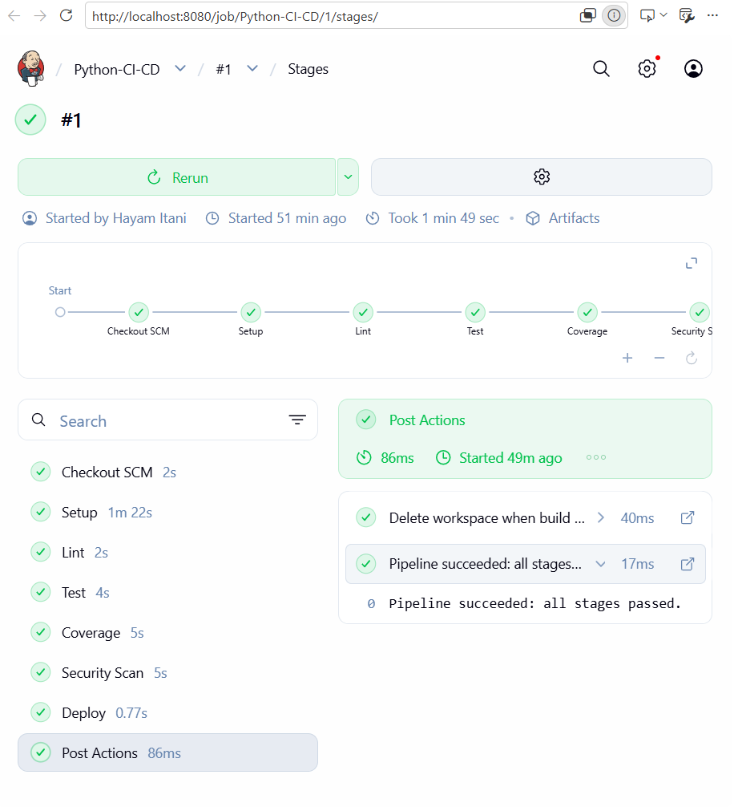
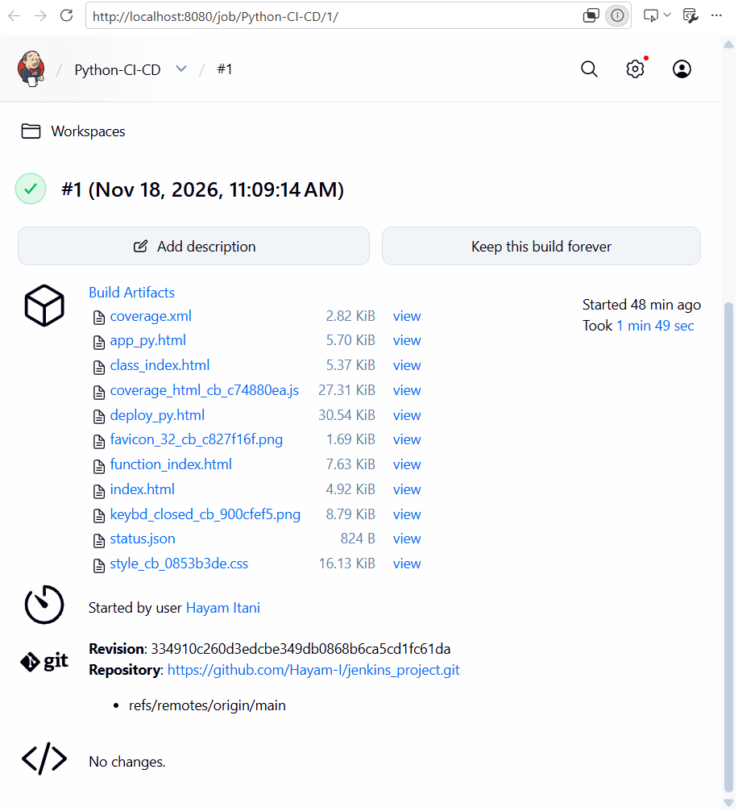
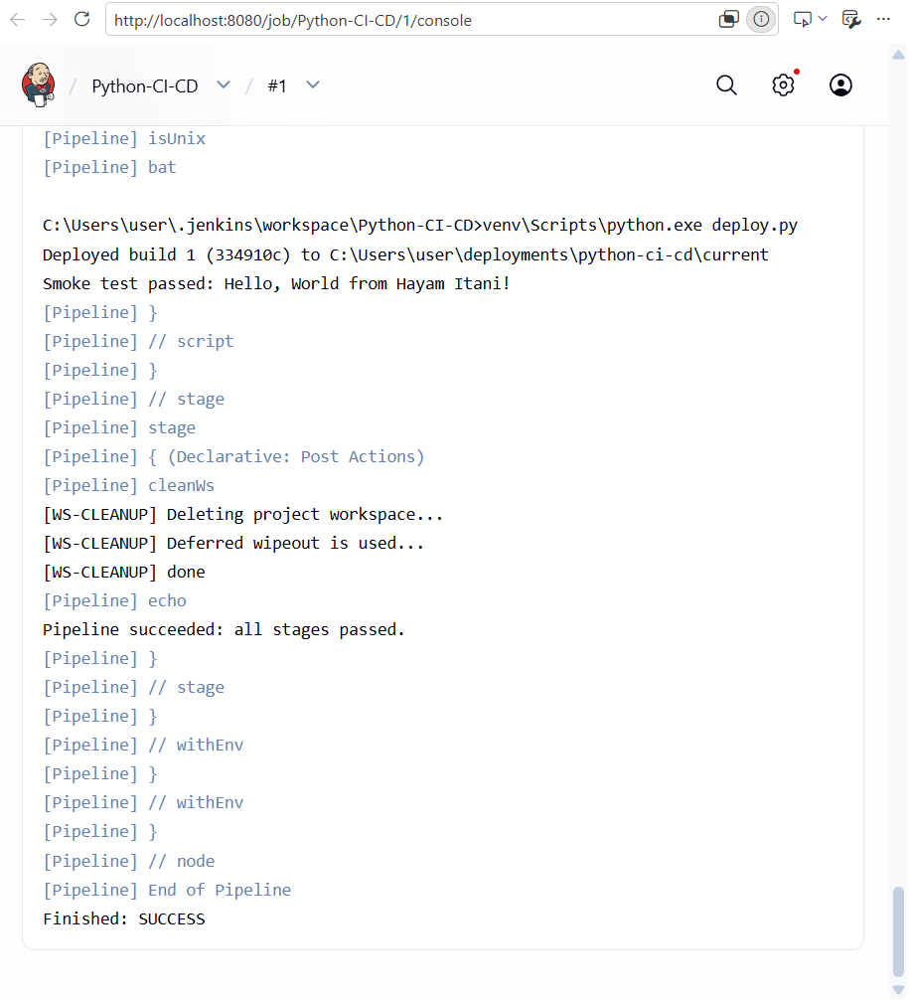

# Lab 10 – Jenkins CI/CD Pipeline for a Python Project

**Student:** Hayam Itani
**Jenkinsfile:** [`Jenkinsfile_Hayam_Itani`](Jenkinsfile_Hayam_Itani)
**Jenkins job:** `Python-CI-CD` (Pipeline script from SCM)

## Project structure

| File | Purpose |
|------|---------|
| `app.py` | Application: `greet(name)` returns `Hello, <name> from Hayam Itani!` |
| `tests/test_app.py` | Unit test for `greet` |
| `tests/test_deploy.py` | Unit tests for the deployment script |
| `deploy.py` | Local deployment script used by the Deploy stage (Part 4) |
| `requirements.txt` | Pinned tools: flake8, pytest, coverage, bandit |
| `pytest.ini` | Points pytest at `tests/` and puts the project root on the import path |
| `.coveragerc` | Coverage settings: measure project code, skip `venv/` and `tests/` |
| `Jenkinsfile_Hayam_Itani` | Declarative pipeline |

## Pipeline stages

| Stage | What it does | Fails the build when |
|-------|--------------|----------------------|
| Setup | Creates `venv` and installs `requirements.txt` | A dependency fails to install |
| Lint | `flake8 app.py deploy.py tests` | Any style error |
| Test | `pytest -v` | Any test fails |
| **Coverage** (Part 4) | `coverage run -m pytest`, then HTML, XML and console reports; HTML report and `coverage.xml` are archived as build artefacts | Total coverage is below 80% |
| **Security Scan** (Part 4) | `bandit -r . -x ./venv,./tests` | Bandit reports any issue |
| **Deploy** (Part 4) | Runs `deploy.py` | The copy or the smoke test fails |

The workspace is wiped after every build (`cleanWs()`), so each build starts from a clean checkout.

## Changes made for Part 4

1. **Coverage stage.** Added `coverage` to the requirements and a `Coverage` stage that runs the test suite under coverage.py, prints a report with missing lines, and writes `htmlcov/` and `coverage.xml`. These are archived on the build page, even if the stage fails. A `--fail-under=80` gate stops the pipeline if coverage drops.
2. **Security Scan stage.** Added `bandit` and a `Security Scan` stage that scans the project's Python code (excluding the virtual environment and tests). Bandit exits with a non-zero code when it finds an issue, which fails the build. I checked this by temporarily adding a file using `subprocess.call(..., shell=True)`: Bandit reported B602/B607/B404 and exited with code 1.
3. **Deployment.** Replaced the `echo` placeholder with `deploy.py`, a simple local deployment that:
   - copies `app.py` and `requirements.txt` to `<DEPLOY_DIR>/current`, outside the Jenkins workspace (default `~/deployments/python-ci-cd`, can be changed with the `DEPLOY_DIR` environment variable);
   - writes `BUILD_INFO.txt` with the Jenkins build number, Git commit and UTC timestamp;
   - smoke-tests the deployed copy by importing it and checking `greet("World")`;
   - refuses unsafe targets: a filesystem root, a folder inside the workspace, or a `current` folder that this script did not create.

   `deploy.py` has its own unit tests, so it is also linted, covered and scanned by the earlier stages.

## Other changes to the lab template

- **Runs on Windows and Linux.** The template uses `sh` and `source venv/bin/activate`, which fail on a Windows Jenkins because Windows virtual environments use `venv\Scripts\`. A small `venvPython()` helper calls the virtual environment's Python directly, using `sh` on Unix agents and `bat` on Windows agents.
- **`pytest` added to `requirements.txt`.** The Test stage runs pytest, but the template only listed flake8.
- **`app.py` greeting updated** to `Hello, {name} from Hayam Itani!` so it matches the required test.
- **Tool versions pinned** so every build installs the same versions.

## Jenkins job configuration

- New Item → Pipeline → name `Python-CI-CD`
- Pipeline → Definition: *Pipeline script from SCM* → SCM: *Git*
- Repository URL: this repository
- Branch Specifier: `*/main`
- **Script Path: `Jenkinsfile_Hayam_Itani`** (the default `Jenkinsfile` would not be found)

## Jenkins build output

Build **#1** of `Python-CI-CD` checked out commit `334910c` from GitHub and finished with **SUCCESS** in 1 min 49 s.

| Stage | Result | Time |
|-------|--------|------|
| Checkout SCM | Passed | 2 s |
| Setup | Passed | 1 min 22 s |
| Lint | Passed: no flake8 errors | 2 s |
| Test | Passed: 10/10 tests | 4 s |
| Coverage | Passed: 98% total (gate is 80%) | 5 s |
| Security Scan | Passed: Bandit found no issues | 5 s |
| Deploy | Passed: deployed and smoke test passed | 0.77 s |

Setup is the slowest stage because every build starts from a clean workspace and installs the tools into a new virtual environment.

### Screenshots

**Stages view:** all stages passed.



**Build summary:** archived coverage report and the Git commit that was built.



**End of the console output:**



### Console output (build #1)

Pipeline bookkeeping lines (`[Pipeline] { ... }`), low-level Git commands and pip download progress are removed for readability. Everything else is exactly as Jenkins printed it.

<details>
<summary>Show console output</summary>

```text
Started by user Hayam Itani
Obtained Jenkinsfile_Hayam_Itani from git https://github.com/Hayam-I/jenkins_project.git
Running on Jenkins in C:\Users\user\.jenkins\workspace\Python-CI-CD

===== Stage: Declarative: Checkout SCM =====
[Pipeline] checkout
Selected Git installation does not exist. Using Default
The recommended git tool is: NONE
No credentials specified
Cloning the remote Git repository
Cloning repository https://github.com/Hayam-I/jenkins_project.git
Fetching upstream changes from https://github.com/Hayam-I/jenkins_project.git
Avoid second fetch
Checking out Revision 334910c260d3edcbe349db0868b6ca5cd1fc61da (refs/remotes/origin/main)
Commit message: "Lab 10: Jenkins CI/CD pipeline"
First time build. Skipping changelog.

===== Stage: Setup =====

> python -m venv venv

> venv\Scripts\python.exe -m pip install -r requirements.txt
Installing collected packages: stevedore, PyYAML, pygments, pyflakes, pycodestyle, pluggy, packaging, mdurl, mccabe, iniconfig, coverage, colorama, pytest, markdown-it-py, flake8, rich, bandit
Successfully installed bandit-1.9.4 coverage-7.17.3 flake8-7.5.0 pytest-9.2.0 (+ dependencies)


===== Stage: Lint =====

> venv\Scripts\python.exe -m flake8 app.py deploy.py tests

===== Stage: Test =====

> venv\Scripts\python.exe -m pytest -v
============================= test session starts =============================
platform win32 -- Python 3.11.9, pytest-9.2.0, pluggy-1.7.0 -- C:\Users\user\.jenkins\workspace\Python-CI-CD\venv\Scripts\python.exe
cachedir: .pytest_cache
rootdir: C:\Users\user\.jenkins\workspace\Python-CI-CD
configfile: pytest.ini
testpaths: tests
collecting ... collected 10 items

tests/test_app.py::TestApp::test_greet PASSED                            [ 10%]
tests/test_deploy.py::TestDeploy::test_default_deploy_dir_is_used_when_unset PASSED [ 20%]
tests/test_deploy.py::TestDeploy::test_deploy_copies_files_and_writes_build_info PASSED [ 30%]
tests/test_deploy.py::TestDeploy::test_deploy_dir_filesystem_root_is_rejected PASSED [ 40%]
tests/test_deploy.py::TestDeploy::test_deploy_dir_inside_project_is_rejected PASSED [ 50%]
tests/test_deploy.py::TestDeploy::test_main_deploys_and_returns_zero PASSED [ 60%]
tests/test_deploy.py::TestDeploy::test_main_returns_one_on_invalid_target PASSED [ 70%]
tests/test_deploy.py::TestDeploy::test_redeploy_replaces_previous_release PASSED [ 80%]
tests/test_deploy.py::TestDeploy::test_refuses_to_overwrite_unmanaged_folder PASSED [ 90%]
tests/test_deploy.py::TestDeploy::test_smoke_test_passes_on_deployed_app PASSED [100%]

============================= 10 passed in 0.19s ==============================

===== Stage: Coverage =====

> venv\Scripts\python.exe -m coverage run -m pytest
============================= test session starts =============================
platform win32 -- Python 3.11.9, pytest-9.2.0, pluggy-1.7.0
rootdir: C:\Users\user\.jenkins\workspace\Python-CI-CD
configfile: pytest.ini
testpaths: tests
collected 10 items

tests\test_app.py .                                                      [ 10%]
tests\test_deploy.py .........                                           [100%]

============================= 10 passed in 0.35s ==============================

> venv\Scripts\python.exe -m coverage html
Wrote HTML report to htmlcov\index.html

> venv\Scripts\python.exe -m coverage xml
Wrote XML report to coverage.xml

> venv\Scripts\python.exe -m coverage report --fail-under=80
Name        Stmts   Miss  Cover   Missing
-----------------------------------------
app.py          2      0   100%
deploy.py      52      1    98%   76
-----------------------------------------
TOTAL          54      1    98%
Post stage
Archiving artifacts

===== Stage: Security Scan =====

> venv\Scripts\python.exe -m bandit -r . -x ./venv,./tests
Run started:2026-11-18 09:11:02.270598+00:00

Test results:
	No issues identified.

Code scanned:
	Total lines of code: 84
	Total lines skipped (#nosec): 0
	Total potential issues skipped due to specifically being disabled (e.g., #nosec BXXX): 0

Run metrics:
	Total issues (by severity):
		Undefined: 0
		Low: 0
		Medium: 0
		High: 0
	Total issues (by confidence):
		Undefined: 0
		Low: 0
		Medium: 0
		High: 0
Files skipped (0):

===== Stage: Deploy =====
Deploying application...

> venv\Scripts\python.exe deploy.py
Deployed build 1 (334910c) to C:\Users\user\deployments\python-ci-cd\current
Smoke test passed: Hello, World from Hayam Itani!

===== Stage: Declarative: Post Actions =====
[WS-CLEANUP] Deleting project workspace...
[WS-CLEANUP] Deferred wipeout is used...
[WS-CLEANUP] done
Pipeline succeeded: all stages passed.
Finished: SUCCESS
```

</details>
